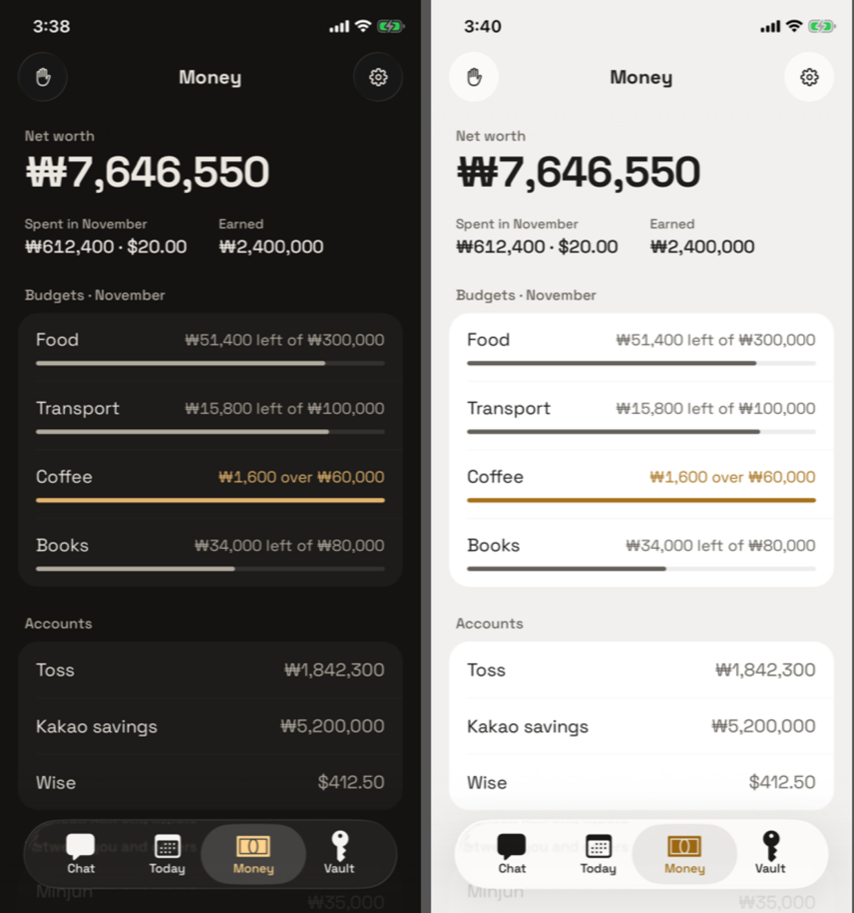
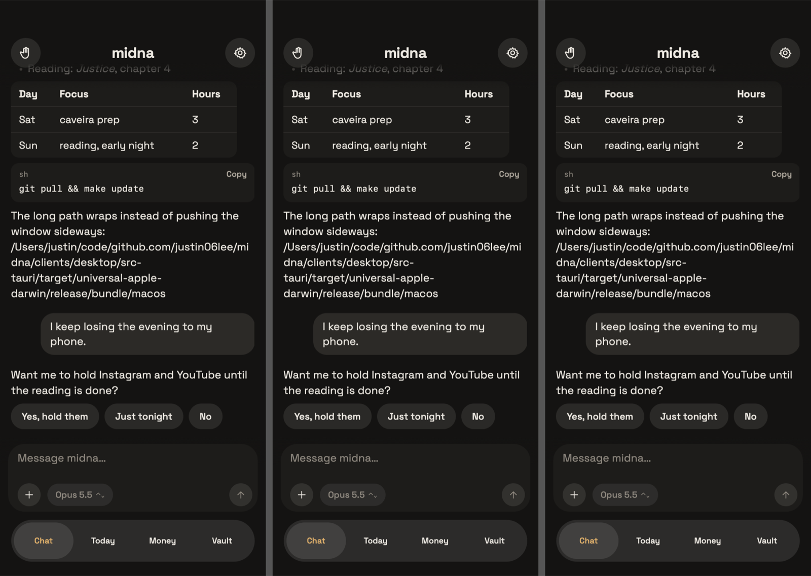
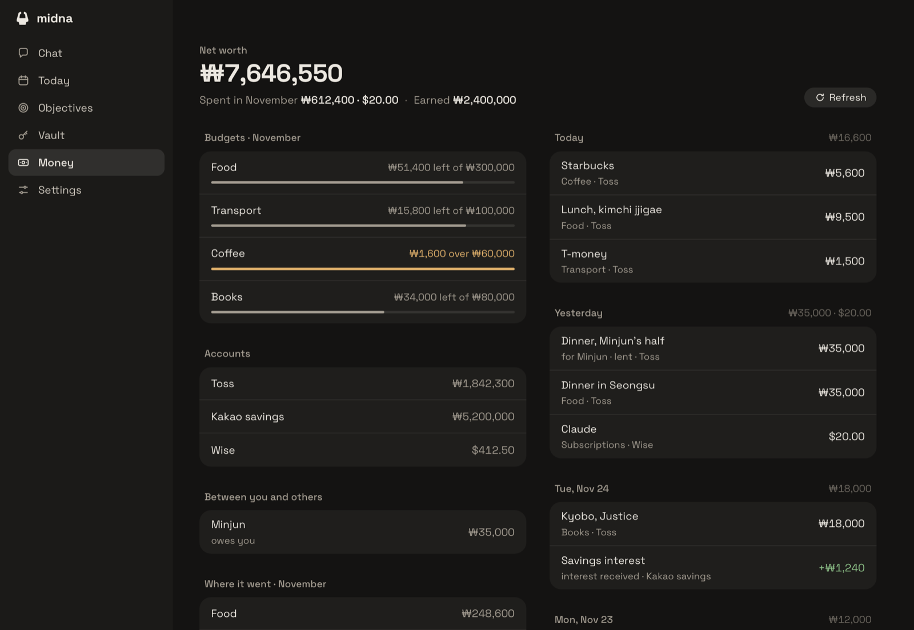

# The ledger (King of Greed)

midna can keep the user's money: where [King of Greed](https://github.com/justin06lee/king-of-greed)'s CLI, `kog`, is installed and set up on midna's host, midna's brain gets the ledger as tools and is told how to use them. On a host without `kog`, nothing of it exists: no tools, no word in the prompt.

midna holds no money data itself. The entries, budgets, riba, purification and zakat are King of Greed's (a Firefly III server, or a file on the host); midna hands its brain `kog`'s own tools, and reads the ledger for the apps' Money view.

## When it is on

`~/.local/bin/kog` exists and `kog status` exits 0 (it has been through `kog init` and the ledger answers). midna asks at startup and before a turn:

- once `kog status` has said yes, the ledger stays on while the CLI is installed, so the prompt and the tools don't flip when the ledger's server is slow for a moment (a call then fails and says why);
- a no is asked again after a minute, so a ledger set up while midna runs is found without a restart. The log says so once: `[midna] ledger: King of Greed, through /home/…/.local/bin/kog`.

`kog` is a script that runs on bun, so bun has to be on the PATH midna's service runs with (it is: the service takes the login shell's PATH when it is installed).

## How the brain gets it

A second MCP server named `kog`, beside `midna`:

- **Claude Code** starts `kog mcp` itself, over stdio, and stops it with the turn.
- **The other harnesses** (Codex, OpenCode, Gemini and the rest, through yagami) take only HTTP servers. For them the daemon answers at `/mcp-kog`, behind the same per-run token as midna's own tools: each request starts `kog mcp`, passes the list or the call through, and stops it.
- **Hermes** keeps its own tools and gets neither.

In ask mode the ledger's tools pass like midna's own: it is the user's book, kept at their word.

What midna records is tagged by `kog` with the name it was set up under (`kog init --name midna`).

## What the prompt says

A "Money" section, only when the ledger is on: log spending the user mentions without being asked ("5,600원 starbucks"), answer "how much did I spend on X" from the ledger, check budgets, track riba, purification and zakat; never invent an entry or guess an amount; and in the morning brief and the evening review, one line on the month's spending against the budgets, only when there is something worth saying.

## In the apps: Money

Where the ledger is on, the iPhone app has a **Money** tab and the Mac app a **Money** item in its sidebar (⌘6). On a host without a ledger neither shows: `GET /v1/status` says `ledger: true` or `false`.

What it shows, top to bottom: net worth with what was spent and earned this month; each budget with what is left and a bar (the accent once it has run over); accounts and their balances; who owes whom; where the month's spending went, by category; interest still to give away and where zakat stands ("the ledger works these out; the ruling is yours"); then the latest entries by day. A ledger with no account and no entry says so, and what to tell midna ([picture](ledger/empty.png)).

It is read-only. An entry is made, changed or removed by telling midna in the chat, whose brain has `kog`'s tools; the view reads again when a turn of midna's ends, when the app comes forward, and on a pull (the phone) or Refresh (the Mac).

**`GET /v1/ledger`** returns the whole view (`Ledger` in `packages/protocol/src/ledger.ts`). The daemon gets it by running `kog`'s own read commands with `--json` (`status`, `budget`, `riba`, `zakat`, `list -n 60`), together, and remembers the answer for ten seconds; `?fresh=1` reads again. Only `kog status` must answer: a part whose command fails comes empty. What `kog` prints is read leniently, since it is another program's output.

- For the user's own devices (desktop, mobile, cli), like the vault: a bridge or the host's own token gets 403.
- 503 where the host keeps no ledger, 502 with what `kog` said when the ledger didn't answer, 404 from a host before 0.13.11.
- `kog zakat` moves the ledger's remembered lunar year along each time it is asked, which is what King of Greed means a daily look to do.

To see it without a ledger: `bun run preview` gives the throwaway midna a stand-in `kog` with a month of entries (`PREVIEW_LEDGER=empty` for none yet, `PREVIEW_LEDGER=none` for a host without a ledger).

## Code

- `packages/agent/src/ledger.ts`: `ledgerWatch` (is it set up), `handleLedgerMcp` (the HTTP bridge), and `readLedger` / `ledgerReader` (the apps' view, from `kog … --json`).
- `packages/protocol/src/ledger.ts`: the `Ledger` shape, and how both apps write money, days, budgets and zakat (`money`, `ledgerDays`, `budgetLine`, `zakatLine`).
- `clients/mobile/src/screens/Money.tsx`, `clients/desktop/src/screens/Money.tsx`: the two views.
- `packages/agent/src/brain.ts`: the `kog` server in both brain paths (`BrainRun.ledger`).
- `packages/agent/src/prompt.ts`: `LEDGER_GUIDE`.
- `packages/daemon/src/server.ts`: `/mcp-kog` and `GET /v1/ledger`. `startDaemon({ ledger })` names another CLI, or `null` for none (the default when a brain is injected, as in tests).
- Tests: `packages/agent/test/ledger.test.ts`, `packages/daemon/test/ledger.test.ts`, `packages/protocol/test/ledger.test.ts`, against the stand-in `packages/agent/test/fake-kog.ts` and its sample ledger `fake-ledger.ts`.
