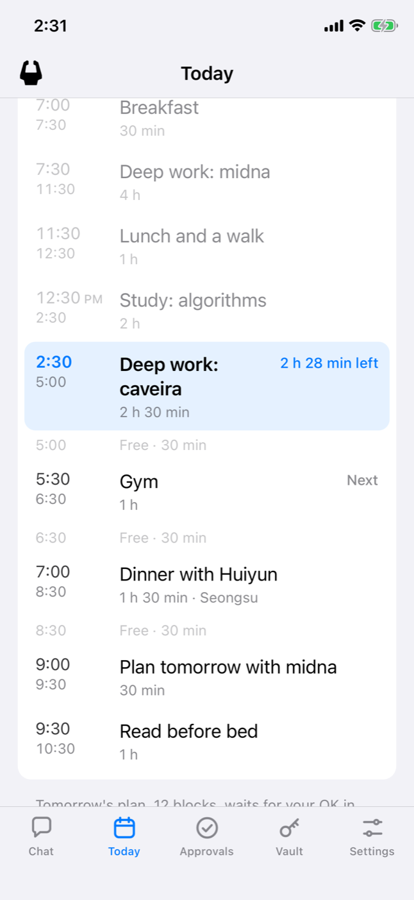

# The Today timetable (iPhone)

The Today tab shows the day as midna planned it: each block's time on the left, the block on now on the accent's faint tone with how long it has left, the next one marked, unplanned stretches of half an hour or more said quietly, and tomorrow's plan below it once approved. It opens scrolled to the block on now.

- **Where the blocks come from:** midna's calendar events (`source` "midna"), and any connected calendar's. `GET /v1/calendar?from=&to=` (epoch ms, at most 31 days) returns those overlapping the window; the phone asks from today's midnight to the day after tomorrow's. A host before 0.13.7 has no such route: the phone falls back to the overview, which starts two hours back.
- **Approval:** midna adds a planned day's blocks `tentative` and sets them `confirmed` once Justin approves (its `event_save` tool says so). Today's tentative blocks show, marked "not approved yet"; tomorrow's show only once approved, and until then the tab says how many wait for the OK.
- **Refreshing:** on opening, on returning to the app, every five minutes, and when one of midna's turns ends; what is on now moves with the clock.
- **Later:** a block's check-in result ("12 pages") goes at the right of its row, where "Next" and the time left sit now.

A screenshot like this one: `bun scripts/sim-shot.ts --build` in `clients/mobile` (a Release build for the simulator, launched against a throwaway midna with a day planned in it, in a timezone where it is mid-afternoon).
